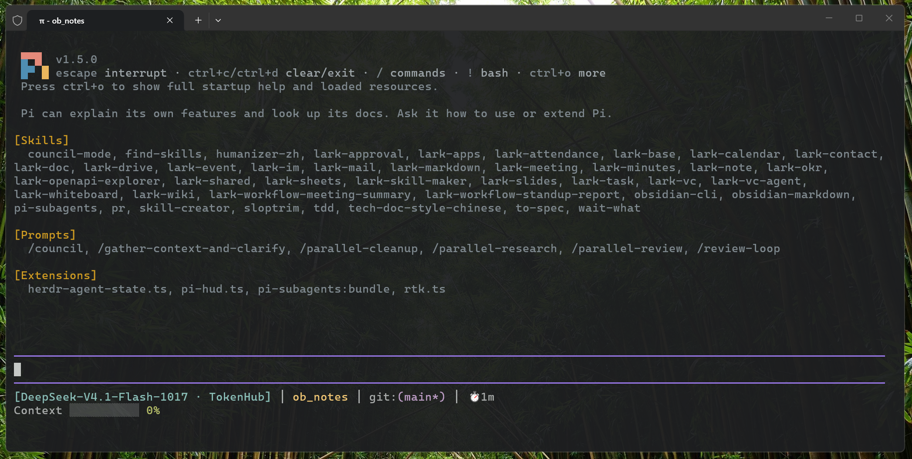

# pi-status-line

A Claude Code-style status line for pi: model, project, git branch, session time and context usage, always in view.

[](LICENSE)



## Install

From a terminal, run:

```
pi install git:github.com/Ziy1-Tan/pi-status-line
```

The HUD takes over the footer when the session starts, and `/hud` turns it off and back on. To update, run `pi update --extensions`, then `/reload` in a running session.

## What you see

The HUD is two lines:

```
[Opus] │ my-project git:(main*) │ ⏱ 12m
Context █████░░░░░ 45%
```

The first line carries the model, the project directory, the git branch (`*` marks uncommitted changes) and the session time. The second draws context usage as a ten-cell bar: green below 70%, yellow from 70%, red from 85%.

The clock counts whole minutes, and renders are throttled to one every five seconds, so a burst of tool calls does not repaint the line.

## Development

```bash
npm install
npm run typecheck
```

`extensions/pi-status-line.ts` is the whole extension. There is no build step: pi loads the TypeScript directly.

## Credits

Layout and colors follow [jarrodwatts/claude-hud](https://github.com/jarrodwatts/claude-hud).

## License

MIT. See [LICENSE](LICENSE).
